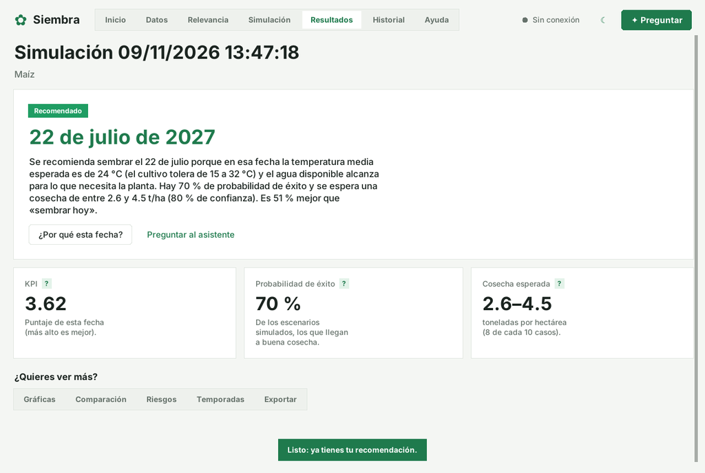
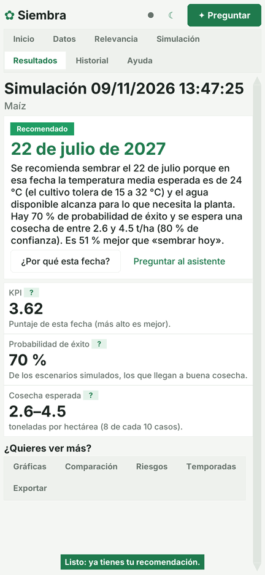
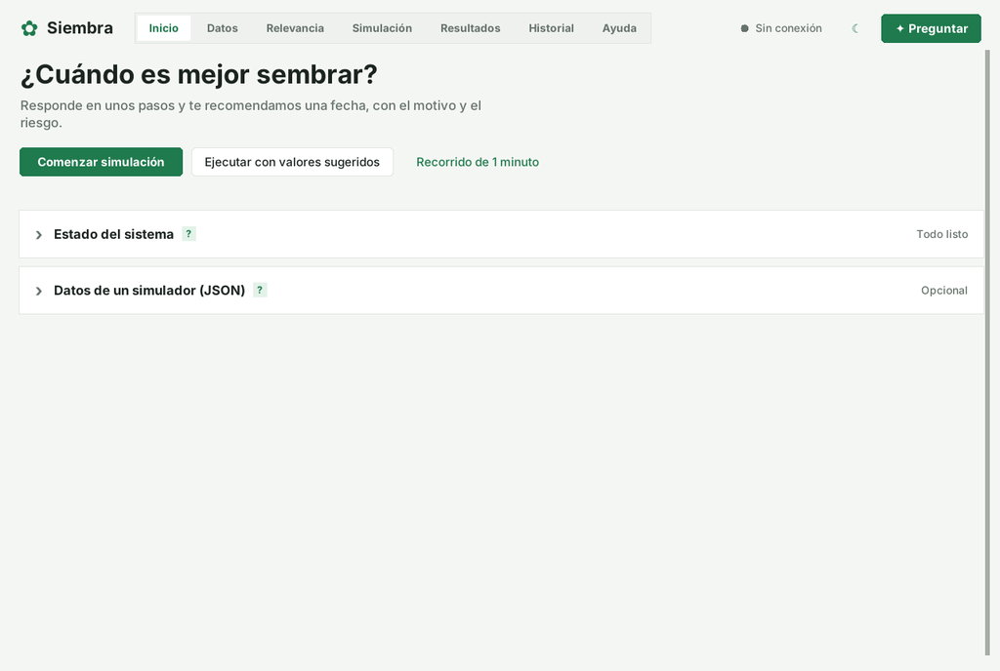
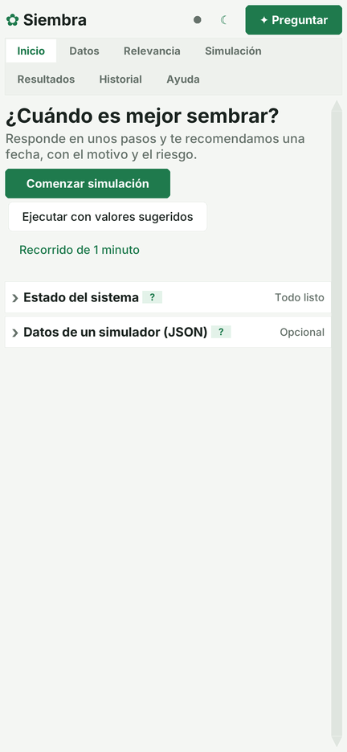
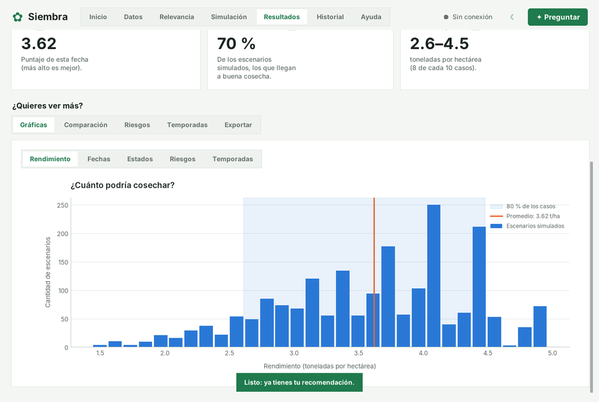
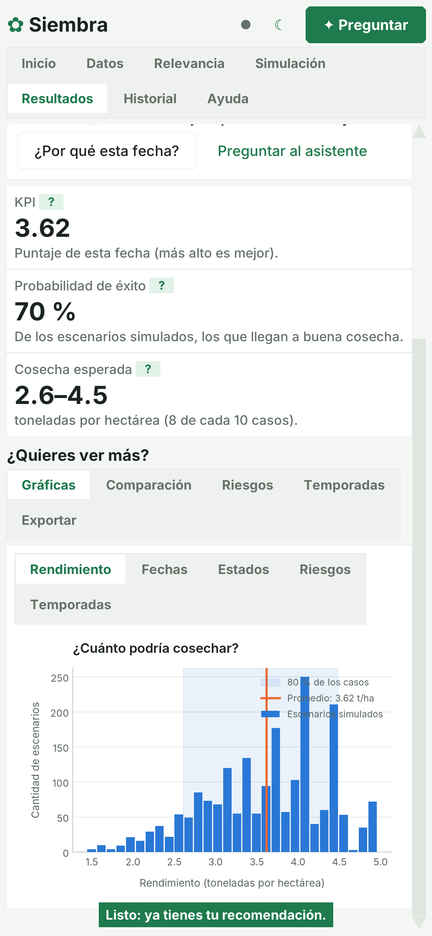
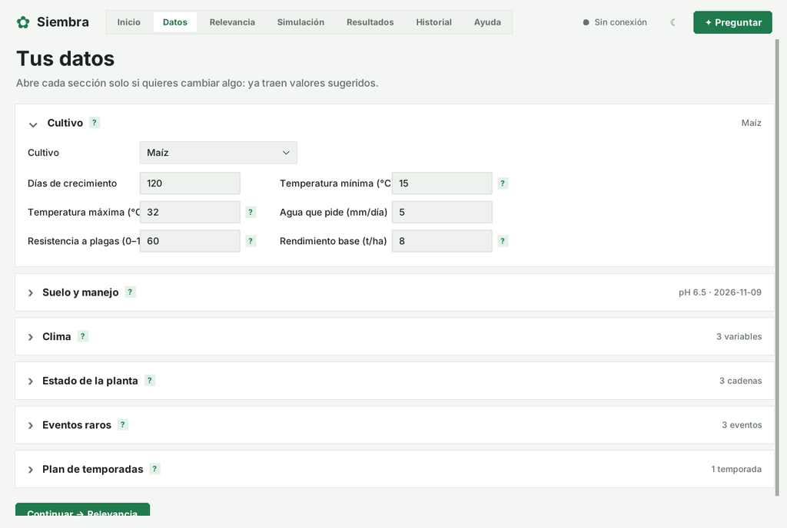
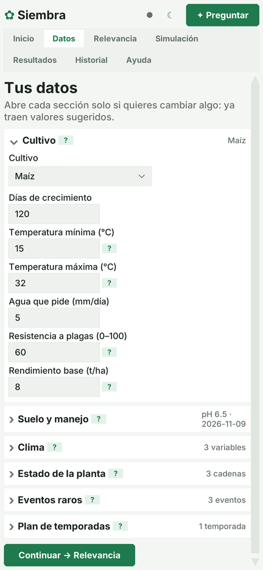
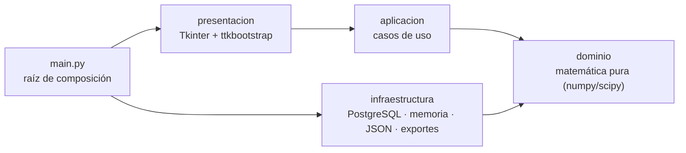

# 🌱 Siembrate · Sistema de Pronóstico de Siembra Adaptable


-4169E1?logo=postgresql&logoColor=white)

[](https://github.com/JuanDavidGranados-FS/pronostico_siembra/actions/workflows/pruebas.yml)


Aplicación que recomienda la **fecha óptima de siembra** de un cultivo y planifica varias temporadas a partir de modelos
probabilísticos. Funciona en el PC y también en celulares Android con [Pydroid 3](docs/android_pydroid.md), con una interfaz que se
adapta sola a la pantalla.

> Proyecto académico del curso **Formulación de Proyectos** — Ingeniería de Sistemas, Universidad ECCI (Bogotá, Colombia).

<p align="center">
  
  &nbsp;
  
</p>

---

## Contenido

- [¿Qué hace?](#qué-hace)
- [Modelos matemáticos](#modelos-matemáticos)
- [Capturas](#capturas)
- [Arquitectura](#arquitectura)
- [Estructura del proyecto](#estructura-del-proyecto)
- [Instalación en el PC](#instalación-en-el-pc)
- [Uso en Android (Pydroid 3)](#uso-en-android-pydroid-3)
- [Base de datos (opcional)](#base-de-datos-opcional)
- [Uso](#uso)
- [Pruebas](#pruebas)
- [Empaquetado](#empaquetado)
- [Documentación](#documentación)
- [Equipo](#equipo)
- [Licencia](#licencia)
- [Aviso](#aviso)

---

## ¿Qué hace?

1. Recibe los datos del cultivo, del suelo y del clima esperado. Todos traen **valores sugeridos**, así que se puede simular sin cambiar nada.
2. Simula miles de escenarios posibles para cada fecha candidata.
3. Recomienda **una fecha** con su justificación en lenguaje natural, la probabilidad de éxito y el rango de cosecha esperado.
4. Muestra bajo demanda gráficas, comparaciones (frente a sembrar hoy o en 30 días), riesgos y un plan de varias temporadas.
5. Guarda cada simulación en un **historial** para buscarla, compararla o reutilizar su configuración.
6. Exporta los resultados a **PDF, Excel, CSV, JSON y PNG**.
7. Puede recibir datos de un simulador o mod externo mediante archivos **JSON** ([guía de integración](docs/integration_guide.md)).

La interfaz muestra la información **por partes**: una pantalla a la vez, secciones plegadas y un solo número destacado. También trae un
asistente sin internet que responde dudas sobre los conceptos.

## Modelos matemáticos

| Modelo | Para qué se usa |
|---|---|
| **Cadenas de Márkov** | Evolución semanal de la salud, la enfermedad y el crecimiento de la planta (matrices editables). |
| **Simulación de Montecarlo** | Clima incierto: temperatura, lluvia y humedad con distribución normal, uniforme o triangular. |
| **Distribución de Poisson** | Eventos raros (plagas, heladas, lluvias intensas) y la pérdida esperada que causan. |
| **Proceso de Galton-Watson** | Plan de 1 a 10 temporadas, con alerta de extinción cuando la media de descendientes es μ < 1. |
| **Factor de Relevancia** | Pesos de 0 a 100 por variable. Se calculan con valores sugeridos, la Ley del Mínimo, un histórico CSV/Excel (Spearman), el modo experto (AHP) o un diario de campo. |

Indicador final: `KPI = rendimiento · relevancia / (1 + esfuerzo)`. Una fecha cuenta como **éxito** si alcanza al menos el 40 % del
rendimiento base, y es **viable** si su probabilidad de éxito es de al menos 10 %.

## Capturas

| Escritorio | Celular (Android) |
|---|---|
|  |  |
|  |  |
|  |  |

## Arquitectura

Arquitectura en capas: la matemática no depende de la interfaz ni de la base de datos.



- **dominio**: Márkov, Montecarlo, Poisson, Galton-Watson, Factor de Relevancia, KPI y entidades. No depende de nada externo.
- **aplicacion**: orquestador de la simulación, validación, historial, diagnóstico, explicador (justificación en texto) y asistente.
- **infraestructura**: repositorios PostgreSQL y en memoria, adaptador JSON, exportador, gráficas, preferencias y registro (log).
- **presentacion**: ventana principal, páginas, widgets propios, tema claro/oscuro y adaptación a celular (`movil.py`).

Más detalle en el [manual técnico](docs/manual_tecnico.md).

## Estructura del proyecto

```text
pronostico_siembra/
├── main.py                     # Punto de entrada: elige PostgreSQL o memoria y abre la ventana
├── requirements.txt            # Dependencias para el PC
├── requirements-android.txt    # Dependencias para Pydroid 3 (Android)
├── db/init.sql                 # Esquema y datos iniciales de PostgreSQL
├── docker/docker-compose.yml   # PostgreSQL listo para usar
├── docs/                       # Manuales, guía de integración, guía de Android y capturas
├── src/
│   ├── dominio/                # Modelos matemáticos y entidades
│   ├── aplicacion/             # Casos de uso
│   ├── infraestructura/        # Persistencia, JSON, exportes, gráficas
│   └── presentacion/           # Interfaz gráfica
│       ├── paginas/            # Una página por pestaña
│       ├── widgets/            # Botones, tarjetas, secciones, desplazamiento táctil…
│       ├── tema.py             # Paletas, tipografía y escala para celular
│       └── movil.py            # Reacomodo automático en pantallas angostas
└── tests/                      # Pruebas con pytest (dominio, aplicación e interfaz)
```

## Instalación en el PC

Requisitos: **Python 3.10 o superior**.

```bash
git clone https://github.com/JuanDavidGranados-FS/pronostico_siembra.git
cd pronostico_siembra
python -m venv .venv
source .venv/bin/activate          # Windows: .venv\Scripts\activate
pip install -r requirements.txt
# Linux: si falta Tkinter ->  sudo apt install python3-tk
```

## Uso en Android (Pydroid 3)

La app corre en el celular con **Pydroid 3** y la interfaz se adapta sola. Los pasos completos (instalación, librerías y problemas
comunes) están en **[docs/android_pydroid.md](docs/android_pydroid.md)**.

En resumen:

```bash
cd /storage/emulated/0/Download/pronostico_siembra
pip install -r requirements-android.txt
```

Después se instalan `numpy`, `scipy` y `matplotlib` desde el menú **Pip** de Pydroid, con la opción *Use prebuilt libraries repository*,
y se abre `main.py` en el editor para correrlo con ▶️.

## Base de datos (opcional)

```bash
cp .env.example .env
docker compose -f docker/docker-compose.yml up -d     # crea el esquema y carga los cultivos
```

Sin PostgreSQL la aplicación funciona igual, con almacenamiento en memoria que se pierde al cerrar. En **Inicio → Estado del sistema**
se ve qué modo está activo y cómo activar la base de datos.

## Uso

```bash
python main.py
```

1. **Inicio**: «Comenzar simulación», o «Ejecutar con valores sugeridos» para obtener una recomendación sin cambiar nada.
2. **Datos**, **Relevancia** y **Simulación**: cada sección se abre solo si quieres cambiarla.
3. **Resultados**: fecha recomendada y su motivo. Bajo demanda: gráficas, comparación, riesgos, temporadas y exportes.
4. **Historial**: buscar, renombrar, reutilizar la configuración y comparar dos simulaciones.
5. **Ayuda**: recorrido guiado, glosario, preguntas frecuentes y guía de integración.

Variables de entorno útiles:

| Variable | Efecto |
|---|---|
| `SIEMBRA_HOME` | Carpeta de preferencias (por defecto `~/.pronostico_siembra`). |
| `SIEMBRA_ENTRADA` | Carpeta que se vigila en busca de archivos JSON externos. |
| `SIEMBRA_MOVIL` | `1` fuerza la interfaz de celular y `0` la desactiva (por defecto se detecta sola). |
| `SIEMBRA_ESCALA` | Ajuste del tamaño de la interfaz en el celular (por ejemplo `1.2`). |

## Pruebas

```bash
pytest --cov                         # la cobertura excluye el repositorio PostgreSQL (necesita una base real)
xvfb-run -a pytest                   # en Linux sin pantalla, para ejecutar también las pruebas de interfaz
SIEMBRA_MOVIL=1 xvfb-run -a -s "-screen 0 1080x2340x24" pytest tests/test_ui.py   # interfaz en modo celular
```

Cubren los casos de verificación CV-01 a CV-06, entre ellos CV-05 (μ < 1 → extinción) y CV-06 (Poisson con λ = 1,5 → P(0) ≈ 22 %).
Con una base de datos real, `tests/test_postgres.py` se activa solo.

## Empaquetado

```bash
pyinstaller --noconfirm --onefile --windowed --name Siembra --add-data "docs:docs" --add-data "db:db" main.py
```

## Documentación

| Documento | Contenido |
|---|---|
| [Manual de usuario](docs/manual_usuario.md) | Cómo usar cada pantalla. |
| [Manual técnico](docs/manual_tecnico.md) | Capas, flujo de simulación, persistencia y adaptación a celular. |
| [Guía de integración](docs/integration_guide.md) | Formato JSON para conectar un simulador o mod externo. |
| [Guía para Android](docs/android_pydroid.md) | Instalación y ejecución en Pydroid 3, con solución de problemas. |
| [Registro de cambios](CHANGELOG.md) | Historial de versiones. |

## Equipo

| Integrante | Rol |
|---|---|
| Edgar Burgos | Líder de proyecto |
| Alejandro Atuesta | Diseño de la interfaz gráfica |
| Oscar Reyes | Ciberseguridad |
| Juan Cipamocha | Programación del motor de simulación |
| Konner Oyola | Arquitectura de datos |

Docente: John Jairo, curso Formulación de Proyectos, Universidad ECCI.

## Licencia

Distribuido bajo la licencia **MIT**. Consulta el archivo [LICENSE](LICENSE).

## Aviso

Las recomendaciones son informativas y no reemplazan el juicio de un profesional. Los valores iniciales son un punto de partida
(referencias: DSSAT y AquaCrop) y no están calibrados para un sitio concreto: confírmalos con un agrónomo antes de usarlos en
agricultura real.
